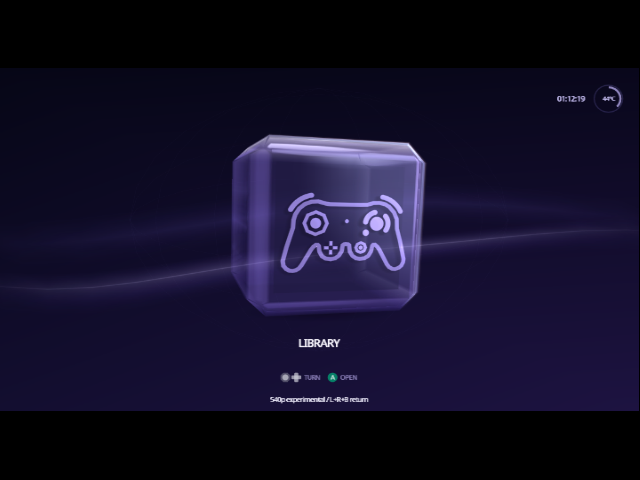

# Experimental 720 x 540 Indigo menus

This is an opt-in build of the actual Indigo interface, separate from the
standalone video diagnostic. Its first target is **720 x 540 progressive at
about 60 frames per second**, with a 16:9 presentation and a normal-mode
fallback. It is not 1280 x 720 rendering. A scaler's HDMI output resolution
does not establish the source resolution or how much source detail survives.

**Retro GEM setup:** use **System > GCDigital Settings > Use Console DE >
On (16:9)**. On the tested setup, the previous setting gave a 720 x 480 input
readout and clipped the upper-left temperature indicator. Selecting 16:9
corrected the framing and changed GEM's input readout to **720 x 540**. The
cube's proportions were reported correct. Record the previous setting before
changing it, plus the GEM firmware and input/output readouts when testing
another setup. Firmware-specific and other-scaler compatibility remain open.

Pixel FX documents the console-boundary control in its
[compatibility guide](https://wiki.pixelfx.co/index.php/Morph_4K_System_Compatibility#Swiss).
The input readout and visual check support transport compatibility on that
setup; they are not a pixel-exact capture of the HDMI output.



Lossless Dolphin demonstration capture, displayed in its 640 x 480 window.
This shows the UI presentation, not Retro GEM's HDMI result.

## Build and run

Use the pinned libogc2 image from CONTRIBUTING.md. Build the normal dependencies
with `make dev`, then build into a separate object directory:

```sh
make -C cube/swiss BUILD=build-540p TARGET=swiss-540p UI_540P=1
```

The result is `cube/swiss/swiss-540p.dol`. `UI_540P` defaults to zero; ordinary
builds retain the SDK's normal VIDEO driver. This experiment requires the
console's digital/component detection flag. Load the DOL through a RAM loader
with a known-good normal build available. An argument `Experimental540p=No`
disables the automatic trial for that launch.

The trial lasts **15 seconds**. Hold **L + R + A** to keep it for the current
RAM session, or **L + R + B** to return to the previous menu mode. Without
confirmation it returns automatically. The on-screen footer identifies the
trial. Confirmation is not saved, and the experiment does not add a saved
video-mode choice. It forces the drawing stage to 16:9 without changing the
stored Menu Widescreen preference. Use a 16:9 presentation on the scaler/TV.
Normal Settings actions still save settings as usual.

A watchdog requests the fallback independently of rendering. If the render
thread cannot process that request within two seconds, it requests a hot
reset to the boot program. A hard GPU/kernel failure can still require the
console's reset button. Before a game or another application starts, the
interface requests its normal menu mode and stops the tiled renderer.

## Rendering

The UI animation, controller sampling and draw functions run once per frame.
Their GX commands are recorded in a bounded 512 KiB display list. That list
is replayed across four rectangles, copied into alternating 720 x 540 YUYV
framebuffers. Each rectangle stays inside a 400 x 274 EFB working area; the
whole image never has to fit in the EFB at once. Horizontal and vertical halos
keep the copied edges away from the working area's edges. Every destination
pixel is written each frame, and each copy destination is 32-byte aligned.

The logical 640 x 480 stage and existing widescreen projection are retained.
This renders geometry and text at the larger source size; it does not resize
a completed 480-line frame. Indexed Jewel Case geometry is emitted into the
outer frame list directly, because nested GX display lists are unsupported.

This first version does **not** use the diagnostic's dirty-region or cached
tile strategies. Animated backgrounds can change most of the image. Reusing
those pixels needs per-buffer history and correct invalidation before it can
be enabled in the interface.

Screen-space refraction, bloom and supersampled Home face pictures are
temporarily bypassed while recording the tiled frame. Their existing EFB
copies assume a complete frame; sampling one tile as a whole frame would be
incorrect. Main cube geometry, direct face icons, text and the Jewel Case's
own material rendering remain. These effects need a separate tile-aware pass
before visual parity can be claimed.

## Timing and source provenance

The experimental driver in `buildtools/video_lab/sdk/` adds one timing to the
pinned libogc2 driver. Its source and hashes are recorded in `provenance.json`.
The parameters come from libogc-rice's HD60 enhanced non-interlaced timing
(`video_timing[31]`), translated into this SDK's mode encoding and horizontal
field layout. It uses **800 x 563 total**, 720 x 540 active, about **59.9467 Hz**
at the nominal 27 MHz pixel rate. The normal timing table is unchanged.

Primary sources:

- [libogc2 VIDEO driver](https://github.com/extremscorner/libogc2/blob/84fec1435413e72e31e7d3d61ed817970bc7f6c3/libogc/video.c)
- [libogc-rice timing table](https://github.com/extremscorner/libogc-rice/blob/5f3be28e50ca9ca2d1689a52139fd9ded78b6a5b/libogc/video.c)

## Qualification

`buildtools/video_lab/run_tests.sh` checks complete tile coverage, EFB bounds,
sample phase, destination alignment, timing blanking/rate, and reconstruction
of the original driver after removing the two marked extensions.

Console-lab `GET /pad` includes a `ui540` snapshot in this build: state,
source size, completed frames, mean/max CPU-to-GPU-fence work, count over
16,682 us, mean completed-frame period and peak display-list size. These are
software measurements, not an HDMI analyzer. State 2 means trial, 3 kept,
5 returned and 6 allocation/start failure. Capturing `/xfb` stalls the draw
thread briefly; measure performance in a window without framebuffer reads.

Qualification must separately establish source bytes, real menu operation,
manual/timed fallback, native frame cadence and the picture after the scaler.
Dolphin captures use RAM XFB/EFB copies (`exact_copies=True`), because a fast
texture-only XFB path can hide an incorrect multi-copy assembly. A console
framebuffer capture proves source memory only; a stable TV picture alone
does not prove all 540 rows survive processing.
